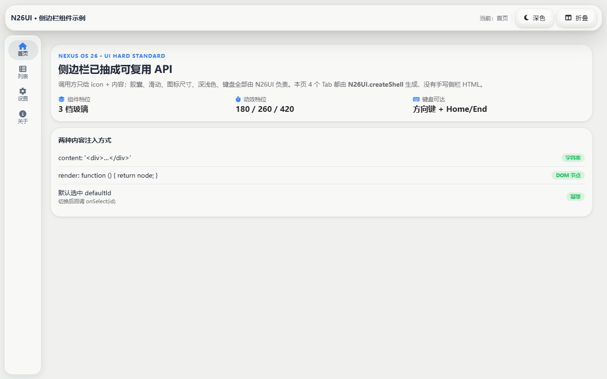
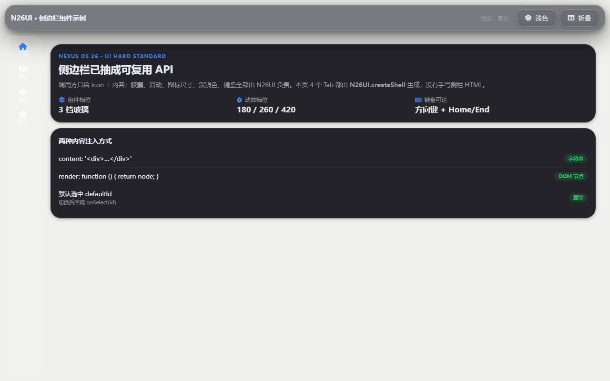

# Nexus OS 26 · UI 硬标准

> 版本：1.0（2026-11-07）
> 适用：`Nexus OS 26.html` 主壳、`apps/` 下全部 iframe 应用、后续新增应用。
> 判定：本文只写**可判定条款**——「必须 / 禁止 / 允许」。每条数值都标注来源文件；没有来源的数值，不允许出现在新代码里。

---

## 0. 优先级与取证方式

1. **令牌优先**：`ui/tokens.css` 是唯一真值源。
2. **现有组件次之**：`ui/glass.css`、`ui/n26-docknav.css`、`ui/n26-shell.css`、`fangui/core/*.css`、`apps/_polish.css`。
3. **本规范第三**：本文件负责把上面两层的散落规矩收口。
4. **个人写法最低**：应用内自定义样式只能引用前两层，不得另起炉灶。

取证命令（Windows PowerShell）：

```powershell
Select-String -Path "ui\tokens.css" -Pattern "glass-blur|dur-fast|r-sm"
Select-String -Path "ui\n26-docknav.css" -Pattern "n26-dng|400|0.42s"
```

> 所有条款都可以在 `apps/_ui-demo.html` 或现有应用里找到对应实现；第 15 节附对照索引。

---

## 1. 令牌（Token）

### 1.1 必须

- **[M-01]** 字号、间距、圆角、阴影、时长、层级必须引用 `ui/tokens.css` 的变量。
- **[M-02]** 需要新颜色时，先确认 `tokens.css` 没有对应项，再在本应用 `:root` 中**以语义命名**声明，且只允许 `hsl()` / `rgba()` 推导，不允许散落 hex。
- **[M-03]** 层级只能用 `--z-*`，禁止手写 `z-index: 9999`（主壳历史弹窗除外，见 `Nexus OS 26.html` `.nex-modal-overlay z-index:9999`，新代码不得效仿）。

现有令牌（来源：`ui/tokens.css`）：

| 类别 | 令牌 | 值 |
|---|---|---|
| 缓动 | `--ease-out-expo` | `cubic-bezier(0.16, 1, 0.3, 1)` |
| 缓动 | `--ease-spring` | `cubic-bezier(0.34, 1.56, 0.64, 1)` |
| 时长 | `--dur-instant / fast / base / slow / slower` | `90 / 160 / 260 / 400 / 560ms` |
| 圆角 | `--r-xs / sm / md / lg / xl / 2xl / full` | `6 / 10 / 14 / 20 / 28 / 36 / 999px` |
| 间距 | `--sp-1 … --sp-8` | `4 / 8 / 12 / 16 / 24 / 32 / 48 / 64px` |
| 字号 | `--fs-11 … --fs-34` | `11 / 12 / 13 / 14 / 16 / 18 / 22 / 28 / 34px` |
| 阴影 | `--sh-card / pop / window / dock` | `0 1 2 + 0 2 8`、`0 4 16 + 0 2 6`、`0 16 48 + 0 4 12`、`0 10 28 + 0 2 8` |
| 层级 | `--z-window / dock / menu / panel / overlay / modal / toast` | `100 / 500 / 800 / 900 / 1000 / 1100 / 1200` |

### 1.2 禁止

- **[X-01]** 禁止新写一套同义变量（`--my-blue`、`--card-radius-2`）。
- **[X-02]** 禁止把 `--r-sm` 在应用里重新定义成别的值来“适配”。
- **[X-03]** 禁止在组件里写 `z-index: 99999` 抢层级。

### 1.3 正确 / 错误

```css
/* ✅ 正确：全部来自令牌 */
.card {
  padding: var(--sp-4);
  border-radius: var(--r-md);
  box-shadow: var(--sh-card);
  font-size: var(--fs-14);
}
```

```css
/* ❌ 错误：自创令牌、写死数值 */
.card {
  --my-card-radius: 13px;
  padding: 17px;
  border-radius: var(--my-card-radius);
  box-shadow: 0 3px 9px rgba(30, 60, 120, .22);
  z-index: 9999;
}
```

---

## 2. 排版

### 2.1 必须

- **[M-04]** 正文基准 `14px`：`font-size: var(--fs-14)`；正文行高 `1.6`。
  - 来源：`ui/tokens.css --fs-14`；`apps/screenshot.html` `.empty .d { font-size:12px; line-height:1.6 }`；主壳 `.n26-covi-sub { line-height:1.65 }`。
- **[M-05]** 可读信息最小 `12px`（`--fs-12`）。
- **[M-06]** 字重只允许 `400 / 500 / 600`。
  - 现有 650/700/750/800 是历史值（`ui/n26-shell.css` `.n26-brand-name font-weight:750`、`Nexus OS 26.html` `.notification-title font-weight:600` 等），**不得继续新增**，重写时收敛到 600。
- **[M-07]** 行高规则：
  - 正文 `1.6`（来源：`.empty .d`）；
  - 标题 `1.3`（来源：主壳 `.desktop-icon-name { line-height:1.3 }`）；
  - 侧栏/控件单行 `1.1`（来源：`ui/n26-docknav.css` `.fm-sidebar-item { line-height:1.1 }`）。
- **[M-08]** 单行文本必须截断，不允许撑破布局：

```css
/* ✅ 正确：单行省略 */
.title {
  font-size: var(--fs-14);
  font-weight: 600;
  line-height: 1.3;
  white-space: nowrap;
  overflow: hidden;
  text-overflow: ellipsis;
}
```

```html
<!-- ❌ 错误：长标题直接换行，把侧栏/卡片挤变形 -->
<div style="font-size:13.7px;font-weight:800">这是一个非常非常长的应用名称，会撑破整个侧边栏布局</div>
```

- **[A-01]** 允许的例外字号：图标下的一行辅助标签 `10.5px`（`ui/n26-docknav.css` `.fm-sidebar-item` / `.as-rail-item`）、徽标计数 `10px`（主壳 `.n26-ldock-trashcount`）、表头 `10.5px`（`apps/monitor.html` `th`）。这些**只能承载辅助信息**，不能放正文。

---

## 3. 间距

### 3.1 必须

- **[M-09]** 一切间距落在 4/8 栅格：4、8、12、16、24、32、48、64（`ui/tokens.css --sp-1…--sp-8`）。
- **[M-10]** 容器内边距：
  - 应用内容区 `18px 20px 24px`（来源：`ui/n26-shell.css` `.as-shell { padding:18px 20px 24px }`）；
  - 设置面板 `2px 2px 26px`，分组卡自带内边距（来源：`Nexus OS 26.html` `.settings-panel { padding:2px 2px 26px }`）。
- **[M-11]** 卡片内边距 `16px`（`--sp-4`）；设置分组卡 `16px 18px 14px`、`margin-bottom:14px`（来源：`Nexus OS 26.html` `.settings-panel .settings-section`）。
- **[M-12]** 卡片/分区间距取 `12px` 或 `16px`（`--sp-3` / `--sp-4`）。现有 `.as-shell { gap:14px }` 是历史近似值，新代码取 16。

### 3.2 正确 / 错误

```css
/* ✅ 正确：4/8 栅格 + 令牌 */
.stack { display: flex; flex-direction: column; gap: var(--sp-3); }
.card  { padding: var(--sp-4); margin-bottom: var(--sp-3); }
```

```css
/* ❌ 错误：13px / 17px / 7px 这类“看着差不多”的数值 */
.stack { gap: 13px; }
.card  { padding: 17px; margin-bottom: 7px; }
```

---

## 4. 圆角

### 4.1 必须

- **[M-13]** 控件（按钮、输入框、小标签）：`10px`（`--r-sm`；主壳 `--btn-radius: 10px`）。
- **[M-14]** 卡片：`14px`（`--r-md`；`fangui/core/flat.css` `.fu-card { border-radius: var(--r-md) }`）。
  - 液态风格下 `fangui/core/liquid.css` 把 `--r-md` 抬到 `22px`、卡片用 `--r-lg` = `30px`；这是既有风格的允许差异，不是新标准。
- **[M-15]** 窗口：`12px`（主壳 `:root --window-radius: 12px`）；对话框 `18px` 或 `20px`（`Nexus OS 26.html` `.nexus-confirm-modal` / `.nex-modal`）。
- **[M-16]** 应用图标：超椭圆，禁止普通 `border-radius` 糊弄。
  - 主壳内：`clip-path: url(#n26Squircle)`（来源：`ui/n26-shell.css` L392；SVG 定义在 `Nexus OS 26.html` L17845-17850，`|x|^5+|y|^5=1`，等效约 `22.4%` 圆角）。
  - iframe 应用：`corner-shape: squircle`（来源：`apps/_polish.css` L133-136；因为 iframe 拿不到主文档的 SVG 定义）。
- **[M-17]** `clip-path` 会裁掉元素自身的 `box-shadow`，阴影必须由父级 `filter: drop-shadow()` 提供。

### 4.2 正确 / 错误

```css
/* ✅ 正确：主壳应用图标 */
.dock-item img,
.app-icon-flat {
  -webkit-clip-path: url(#n26Squircle);
  clip-path: url(#n26Squircle);
}
.tile-icon { filter: drop-shadow(0 3px 6px rgba(0, 0, 0, .18)); }

/* ✅ 正确：iframe 应用图标 */
.app-icon { corner-shape: squircle; border-radius: 22.4%; }
```

```css
/* ❌ 错误：图标用小圆角方块 + 自己加阴影（裁切后阴影消失） */
.app-icon {
  border-radius: 6px;
  clip-path: url(#n26Squircle);
  box-shadow: 0 6px 18px rgba(0, 0, 0, .2);
}
```

---

## 5. 玻璃三档

> 总原则（来源：`ui/tokens.css` L25-43）：**饱和度 ≤150%、一律不做 `brightness` 增亮、描边用黑色发丝边、高光只留顶部一条。**
> 分档只靠「模糊半径 + tint 透明度 + 阴影」，不靠提亮。

### 5.1 必须

- **[M-18]** 窗口档：`.glass`（来源：`ui/glass.css` L12-20）
  - `background: var(--glass-tint)` → `rgba(255,255,255,.55)`
  - `backdrop-filter: blur(18px) saturate(148%)`
  - `border: 1px solid rgba(0,0,0,.10)`
  - `box-shadow: 0 16px 48px rgba(0,0,0,.16), 0 4px 12px rgba(0,0,0,.08), inset 0 1px 0 rgba(255,255,255,.35)`
- **[M-19]** 菜单/大面板档：`.glass-strong`（来源：`ui/glass.css` L23-29）
  - `background: var(--glass-tint-2)` → `rgba(255,255,255,.34)`
  - `backdrop-filter: blur(20px) saturate(148%)`
  - `border: 1px solid rgba(0,0,0,.10)`
  - `box-shadow: 0 20px 56px rgba(0,0,0,.18), 0 6px 16px rgba(0,0,0,.10), inset 0 1px 0 rgba(255,255,255,.35)`
- **[M-20]** Dock 档（来源：`Nexus OS 26.html` L3484-3543；`ui/tokens.css --glass-blur-dock:18px`）
  - 胶囊圆角 `34px`，`padding: 10px 14px`，图标间距 `6px`
  - 底色 `rgba(255,255,255,.16)` + 顶部高光渐变
  - 边框 `1px solid rgba(255,255,255,.45)`
  - 阴影 `inset 0 1px 0 rgba(255,255,255,.55), inset 0 -1px 0 rgba(0,0,0,.06), 0 12px 40px rgba(0,0,0,.24), 0 2px 8px rgba(0,0,0,.10)`
  - 深色 `rgba(18,20,32,.42)`
- **[M-21]** 侧栏（dock 导航）玻璃：`rgba(255,255,255,.50)` / 边框 `.62` / 圆角 `16px` / 阴影 `inset 0 1px 0 .70, 0 6px 18px rgba(20,40,70,.10)`（来源：`ui/n26-docknav.css` `.fm-sidebar[data-n26dock]`）。
- **[M-22]** 一个屏幕内的模糊层数越少越好；应用主动声明 `.n26-glass` 才开启模糊（`apps/_polish.css` L207-219），禁止全局 `* { backdrop-filter }`。

### 5.2 禁止

- **[X-04]** 禁止 `brightness()`：`tokens.css` 已把 `--glass-brightness` 显式设为 `1`（L35）。主壳旧 `.glass` 的 `brightness(1.05)`、`#n26LeftDock` 的 `brightness(1.06)` 属于历史值，不得复制。
- **[X-05]** 禁止双层白边：`border: 1px solid #fff` 再加 `::before` 一圈白描边。只留一条顶边 specular（`ui/glass.css` `.glass--specular::before`）。
- **[X-06]** 禁止 `saturate(>150%)`；主壳旧 `#startMenu { blur(40px) saturate(180%) }` 是历史值，新代码用 `--glass-blur-panel:16px` / `--glass-saturate:148%`。

### 5.3 正确 / 错误

```html
<!-- ✅ 正确：结构面直接用现成玻璃层 -->
<section class="glass">…</section>
<aside class="glass-strong">…</aside>
```

```css
/* ❌ 错误：自调配方 + 提亮 + 双层白边 */
.my-panel {
  background: rgba(255,255,255,.72);
  backdrop-filter: blur(40px) saturate(180%) brightness(1.1);
  border: 1px solid #fff;
  box-shadow: inset 0 0 0 1px #fff, 0 20px 60px rgba(0,0,255,.2);
}
```

---

## 6. 颜色

### 6.1 必须

- **[M-23]** 主色 = Nexus 蓝：`var(--primary)` → `#3b82f6`（`ui/tokens.css` L75）。
  - 按压态 `--primary-press: #2563eb`。
  - 侧栏选中图标使用 `--n26dock-accent: #2f7cf6`（`ui/n26-docknav.css` L13）。
  - 主壳旧 `--primary: #4A9BF5`（`Nexus OS 26.html` L33）仅供既有窗口内部使用，**不得带入新应用**。
- **[M-24]** 语义色只表达状态，不表达强调：
  - `--danger:#ef4444`、`--ok:#22c55e`、`--warn:#f59e0b`（`ui/tokens.css` L77-79）。
  - 状态色可以出现在图标、徽标、边框，但**不能**拿来做大面积背景或主按钮。
- **[M-25]** 文本层级：`--text-1 / --text-2 / --text-3`（浅色 `rgba(15,23,42,.92/.62/.42)`；深色 `rgba(240,244,252,.96/.70/.48)`）。
- **[M-26]** 第三方品牌色只做点缀：允许出现在 `24px` 图标块里（如 `ui/n26-shell.css` `.settings-item > i` 的 `#5b8def / #f59e0b / #10b981`），面积不得超过 `32px × 32px`。

### 6.2 禁止

- **[X-07]** 禁止整页渐变背景：`body { background: linear-gradient(...) }`。
- **[X-08]** 禁止黑紫主题：深色底只允许 `rgba(20,24,34,.55)` / `#141824` 这类中性墨色（`ui/tokens.css` dark 段）；禁止 `#000 + #8b00ff` 紫调。
- **[X-09]** 禁止用语义色当品牌主色（例如把整个按钮组刷成红色）。
- **[X-10]** 禁止在应用里写 `#3b82f6` 字面量；必须 `var(--primary)`。

### 6.3 正确 / 错误

```css
/* ✅ 正确 */
.btn-primary   { background: var(--primary); color: #fff; }
.btn-primary:active { background: var(--primary-press); }
.badge-error   { color: var(--danger); background: rgba(239, 68, 68, .12); }
```

```css
/* ❌ 错误：整页渐变 + 黑紫 + 写死 hex */
body { background: linear-gradient(135deg, #1a0033, #000); }
.btn { background: #8b00ff; color: #fff; }
```

---

## 7. 侧边栏

### 7.1 必须

- **[M-27]** 新增应用禁止手写侧栏；必须调用 `N26UI.createShell()`（`ui/n26-ui.js`）。
- **[M-28]** 尺寸：宽 `76px`（`ui/n26-docknav.css` `.fm-sidebar[data-n26dock]` / `.settings-sidebar`），`padding: 7px 5px`，圆角 `16px`，项间距 `3px`。
- **[M-29]** 项：`padding: 7px 0 6px`、`margin-bottom: 2px`、圆角 `11px`、图标 `15px`、文字 `10.5px / 1.1`。
- **[M-30]** 胶囊指示器：`border-radius:999px`、底色 `rgba(125,135,155,.16)`、内高光 `inset 0 1px 0 rgba(255,255,255,.35)`（`ui/n26-docknav.css` `.n26-dng`）。
- **[M-31]** 选中态：文字 `#1c2b3a`、图标 `var(--n26dock-accent)`；深色文字 `#eef3fa`。
- **[M-32]** 悬停：浅色 `rgba(255,255,255,.85)`；深色 `rgba(255,255,255,.12)`（`.as-rail-item:hover` 同源值）。
- **[M-33]** 禁用：文字 `var(--text-3)` + `cursor:not-allowed`（`apps/_polish.css`），并且必须 `aria-disabled="true"`、不可聚焦。
- **[M-34]** 滑动动画必须复用 docknav 配方：
  - 滑行 `400ms`、`cubic-bezier(.3,.7,.3,1)`、过冲 `0.16`；
  - 滑行中玻璃 `blur(14px) saturate(1.5)`、白边 `.55`、阴影 `0 10px 26px rgba(20,40,70,.16)`；
  - 图标弹跳 `400ms`（`0.76 → 1.12 → 1`）；
  - 内容轻推 `420ms`。
  - 来源：`ui/n26-docknav.css` `.n26-dng.travel` / `.n26-icon-pop` / `.n26-nudge-*`；`ui/n26-ui.js` 同值实现。
- **[M-35]** 折叠：`≤760px` 自动只留图标（断点来源 `ui/n26-shell.css` L644）；折叠宽 `48px`（取 `--sp-7`），文字隐藏，图标不换行、不挤出布局。

### 7.2 正确 / 错误

```js
// ✅ 正确：调用方只给 icon + 内容
N26UI.createShell(document.getElementById('app'), {
  defaultId: 'home',
  sidebar: [
    { id: 'home', icon: 'fa-house', label: '首页', content: '<div>…</div>' },
    { id: 'about', icon: 'fa-circle-info', label: '关于', render: () => node }
  ],
  onSelect: id => {}
});
```

```html
<!-- ❌ 错误：自己写一套侧栏，尺寸/选中态/动画全部对不上 -->
<aside style="width:180px;background:#fff">
  <div class="my-nav active" onclick="go('home')">首页</div>
  <div class="my-nav" onclick="go('about')">关于</div>
</aside>
```

---

## 8. 组件

> 所有组件都必须同时满足：浅色 + 深色、键盘可见焦点、`prefers-reduced-motion` 降级。

### 8.1 按钮

- **[M-36]** 结构按钮用 `.glass-btn`（主壳）或 `.fu-btn`（iframe）。
  - `.glass-btn`：`padding:10px 20px`、`border-radius:var(--btn-radius)=10px`、`font-size:14px`、`transition 0.18s`（`Nexus OS 26.html` L102-118）。
  - `.fu-btn`：`padding:var(--sp-2) var(--sp-4)`、`gap:var(--sp-2)`、`border-radius:var(--r-sm)`（`fangui/core/flat.css` L19-30）。
- **[M-37]** 悬停 `translateY(-2px) scale(1.04)`、按压 `scale(0.97)`（`.glass-btn` + `apps/_polish.css` 的独立 `scale`）。

```html
<!-- ✅ 正确 -->
<button class="fu-btn fu-btn--accent"><i class="fa-solid fa-check"></i>保存</button>
<button class="glass-btn">取消</button>
```
```html
<!-- ❌ 错误：自绘圆角/自定字号 + 无语义 -->
<div onclick="save()" style="padding:12px 18px;border-radius:14px;font-size:15px">保存</div>
```

### 8.2 输入

- **[M-38]** `padding:10px 14px`、`border-radius:10px`、`font-size:13px`、底色 `rgba(0,0,0,.03)`、边框 `1px solid rgba(0,0,0,.10)`、聚焦边框 `var(--primary)`（`Nexus OS 26.html` `.nex-modal-field input`）。
- **[M-39]** iframe 内用 `.fu-input`：`padding:var(--sp-2) var(--sp-3)`、圆角 `--r-sm`；聚焦 `box-shadow:0 0 0 3px var(--accent-ring)`（`fangui/core/flat.css` L38-48）。
- **[M-40]** 必须给 `aria-label` 或 `<label for>`。

```html
<!-- ✅ 正确 -->
<label for="q" class="lbl">搜索</label>
<input id="q" class="fu-input" type="search" placeholder="输入关键字…">
```
```html
<!-- ❌ 错误：无标签 + 自定 13.5px + 圆角 6px -->
<input style="padding:9px;border-radius:6px;font-size:13.5px" placeholder="搜索">
```

### 8.3 开关（`.fu-switch` 液态玻璃四段）

- **[M-41]** 尺寸：`40 × 22`，滑块 `20 × 16`，滑块静止左偏移 `2px`，行程 `16px`（`fangui/core/liquid.css` L86-98）。
- **[M-42]** 关闭轨道 `#d7d9de`，开启 `#34c759`，深色开启 `#30d158`。
- **[M-43]** 四段动效（`ui/n26-switch.js` L15-19）：
  1. `90ms` 滑块胀大；
  2. `60ms` 转液态玻璃；
  3. `260ms` 水滴滑行；
  4. `260ms` 轨道变绿 + 收成胶囊。
- **[M-44]** 必须带 `role="switch"` 与 `aria-checked`；业务状态由调用方切换 `.on`，脚本只补动画（`ui/n26-switch.js` 头注释 L8-9）。

```html
<!-- ✅ 正确 -->
<button type="button" class="fu-switch on" role="switch" aria-checked="true" aria-label="深色模式"></button>
```
```html
<!-- ❌ 错误：自己画圆点 + 无 aria + 线性动画 -->
<div class="my-toggle" onclick="this.classList.toggle('on')">
  <span style="transition:left .2s linear"></span>
</div>
```

### 8.4 卡片

- **[M-45]** 卡片圆角 `var(--r-md)=14px`、内边距 `var(--sp-4)=16px`、阴影 `var(--sh-card)`（`fangui/core/flat.css` `.fu-card`）；设置分组卡 `20px / 16px 18px 14px`、底色 `rgba(255,255,255,.74)`、边框 `rgba(255,255,255,.6)`、阴影 `0 4px 18px rgba(15,23,42,.06) + inset 0 1px 0 rgba(255,255,255,.75)`（`Nexus OS 26.html` `.settings-panel .settings-section`）。
- **[M-46]** 卡片不要叠第二层玻璃；需要层级差就用 `--surface` 与 `--surface-2/3` 的 3% 明度差（`fangui/core/tokens.css`）。

```html
<!-- ✅ 正确 -->
<div class="fu-card">…</div>
```
```css
/* ❌ 错误：卡片再套一层 backdrop-filter，模糊层数翻倍 */
.fu-card { backdrop-filter: blur(20px); background: rgba(255,255,255,.6); }
```

### 8.5 表格

- **[M-47]** 表格 `font-size:12.5px`、表头 `10.5px / uppercase / letter-spacing:.5px`、`th` 内边距 `6px 8px`、`td` 内边距 `8px`、最后一行去掉下边框（`apps/monitor.html` L104-111）。现有表头字重 `700` 属历史值，新代码按 M-06 收敛到 `600`。
- **[M-48]** 数字列必须 `font-variant-numeric: tabular-nums`（`apps/_polish.css` `.n26-num`）。

```html
<!-- ✅ 正确 -->
<table class="demo-table">
  <thead><tr><th>应用</th><th>内存</th></tr></thead>
  <tbody><tr><td>音乐</td><td class="n26-num">18.7 MB</td></tr></tbody>
</table>
```
```html
<!-- ❌ 错误：表头 14px 粗体、单元格 15px、数字不对齐 -->
<table><thead><tr><th style="font-size:14px;font-weight:800">应用</th></tr></thead></table>
```

### 8.6 对话框

- **[M-49]** 主壳对话框：宽 `480px`、圆角 `20px`、内边距 `28px`、底色 `rgba(255,255,255,.78)`、`blur(30px) saturate(160%)`、边框 `rgba(0,0,0,.06)`、阴影 `0 20px 60px rgba(0,0,0,.18)`；遮罩 `rgba(0,0,0,.6) + blur(10px)`（`Nexus OS 26.html` `.nex-modal` / `.nex-modal-overlay`）。
- **[M-50]** 确认框宽 `420px`、圆角 `18px`、内边距 `32px 36px`、底色 `rgba(255,255,255,.82)`、阴影 `0 24px 70px rgba(0,0,0,.18)`；进场 `scale(0.9) → 1`，`0.3s cubic-bezier(.34,1.56,.64,1)`（`Nexus OS 26.html` `.nexus-confirm-modal`）。
- **[M-51]** 必须 `role="dialog"` + `aria-modal="true"` + 焦点落在第一个可操作项；Esc 关闭。

```html
<!-- ✅ 正确 -->
<div class="nex-modal-overlay show" role="dialog" aria-modal="true" aria-labelledby="dlgTitle">
  <div class="nex-modal"><h3 id="dlgTitle" class="nex-modal-title">确认操作</h3></div>
</div>
```
```html
<!-- ❌ 错误：无 role、无焦点管理、用 alert() 代替 -->
<div onclick="alert('确定吗')" style="position:fixed;inset:0;background:#000">…</div>
```

### 8.7 Toast / 通知

- **[M-52]** 尺寸：`min-width:280px`、`max-width:360px`、内边距 `14px 18px`、圆角 `12px`。
- **[M-53]** 材质：`rgba(255,255,255,.82)` + `blur(20px) saturate(160%)` + 边框 `rgba(0,0,0,.08)` + 阴影 `0 8px 30px rgba(0,0,0,.15)`。
- **[M-54]** 进场 `0.42s --ease-out`，退场 `0.28s --ease-in`；层级 `--z-toast:1200`（`Nexus OS 26.html` `.notification` L8383-8408）。
- **[M-55]** iframe 应用没有宿主 `.notification` 时，用 `.glass-strong` 复刻上述尺寸，不得自创第三种尺寸。

```html
<!-- ✅ 正确（主壳） -->
<div class="notification"><div class="notification-title">已保存</div><div class="notification-body">设置已生效</div></div>
```
```css
/* ❌ 错误：全屏横幅、颜色高饱和、动画 2s */
.toast { position:fixed;inset:0;background:#ff0000;transition:all 2s linear; }
```

### 8.8 空态

- **[M-56]** 结构：图标（`38–42px`、`opacity:.35`）+ 标题（`14px/600`）+ 说明（`12px/1.6`）+ 一个下一步动作，`gap:12px`、`padding:60px 20px`（`apps/screenshot.html` `.empty` L149-156；`apps/games.html` `.empty` L93-94）。
- **[M-57]** 空态必须给「为什么空 + 下一步做什么」，禁止只放一句“暂无数据”。

```html
<!-- ✅ 正确 -->
<div class="empty">
  <i class="fa-solid fa-inbox" aria-hidden="true"></i>
  <span class="t">还没有项目</span>
  <span class="d">新建第一个项目后，这里会显示进度。</span>
  <button class="fu-btn fu-btn--accent">新建项目</button>
</div>
```
```html
<!-- ❌ 错误：一个孤零零的文字 -->
<div>暂无数据</div>
```

### 8.9 骨架屏

- **[M-58]** 骨架块：`background: rgba(255,255,255,.20)`、圆角 `var(--r-sm)`，只允许 `transform/opacity` 动效；扫光 `1.5s var(--ease-in-out-quart)`（来源：`Nexus OS 26.html` `.install-bar-fill::after` / `@keyframes shimmerLight`，L1851-1873）。
- **[M-59]** 骨架尺寸必须与真实内容一致，避免加载完成时跳动。

```css
/* ✅ 正确：只动 transform */
.n26-skeleton {
  position: relative;
  overflow: hidden;
  height: 14px;
  border-radius: var(--r-sm);
  background: rgba(255, 255, 255, .20);
}
.n26-skeleton::after {
  content: "";
  position: absolute; inset: 0;
  background: linear-gradient(90deg, transparent, rgba(255,255,255,.4), transparent);
  animation: n26Skeleton 1.5s var(--ease-in-out-quart) infinite;
}
@keyframes n26Skeleton { from { transform: translateX(-100%); } to { transform: translateX(100%); } }
```
```css
/* ❌ 错误：用 width 动画，逐帧重排 */
.skeleton::after { animation: grow 1.5s linear infinite; }
@keyframes grow { from { width: 0; } to { width: 100%; } }
```

### 8.10 加载态 / 错误态

- **[M-60]** 加载态：优先骨架屏；需要进度时用 `.fu-progress`（高 `6px`、圆角 `3px`、填充 `--accent`，`fangui/core/flat.css` L65-66）。
- **[M-61]** 错误态：沿用空态结构，图标用 `--danger`，必须给「重试」按钮 + 一句可读原因；禁止只留白屏。
- **[M-62]** 三种状态（空 / 加载 / 错误）缺一不可，`apps/_template.html` L23 已把它列为铁律。

```html
<!-- ✅ 正确 -->
<div class="empty">
  <i class="fa-solid fa-triangle-exclamation" style="color:var(--danger)" aria-hidden="true"></i>
  <span class="t">加载失败</span>
  <span class="d">无法连接本地桥，请确认 nexus-bridge 正在运行。</span>
  <button class="fu-btn" onclick="retry()">重试</button>
</div>
```
```html
<!-- ❌ 错误：白屏 / 只弹 alert -->
<div id="app"></div>
<script>fetch(url).catch(() => alert('失败'))</script>
```

---

## 9. 动效

### 9.1 必须

- **[M-63]** 三档时长（视觉验收值）：

| 档位 | 值 | 现有实现出处 | 令牌 |
|---|---|---|---|
| 快 | `180ms` | `Nexus OS 26.html` `.glass-btn transition 0.18s`；`apps/_polish.css --n26-dur-fast:0.16s` | `--dur-fast` (160ms) |
| 中 | `260ms` | `ui/tokens.css --dur-base:260ms`；`ui/n26-switch.js T.slide=260` | `--dur-base` |
| 慢 | `420ms` | `ui/n26-docknav.css .n26-nudge-* animation-duration:.42s`；`.notification` 0.42s | `--dur-slow` (400ms) |

> 写代码优先用 `var(--dur-fast/base/slow)`；与 180/260/420 相差 ≤20ms 视为同档，不得再出现 300ms、0.5s 这类孤立值。

- **[M-64]** 主曲线 `cubic-bezier(.16, 1, .3, 1)`（`--ease-out-expo`）；回弹 `cubic-bezier(.34,1.56,.64,1)`（`--ease-spring`）；侧栏滑行 `cubic-bezier(.3,.7,.3,1)`。
- **[M-65]** 几何动效只动 `transform` / `opacity`；颜色与阴影可以过渡（不触发重排），但禁止过渡 `width / height / top / left / margin / padding`。
- **[M-66]** 必须尊重 `prefers-reduced-motion`：`ui/tokens.css` L112-115 已把时长归零；`ui/n26-ui.css` 关闭指示器/轻推动画。
- **[M-67]** 性能模式 `body.perf-mode` 下关闭模糊与新增反馈（`apps/_polish.css` L262-270）。

### 9.2 正确 / 错误

```css
/* ✅ 正确 */
.tab { transition: transform 260ms var(--ease-out-expo), opacity 260ms var(--ease-out-expo); }
.tab:hover { transform: translateY(-1px); }
```

```css
/* ❌ 错误：动布局尺寸 + linear */
.tab { transition: all .3s linear; }
.tab:hover { width: 120px; height: 48px; margin-left: 6px; }
```

---

## 10. 深浅色

### 10.1 必须

- **[M-68]** 两套都必须成立；深色**不是简单反色**：白边 + 中性黑影。
  - 来源：`ui/tokens.css` L92-109：`--glass-border` 变 `rgba(255,255,255,.14)`、`--glass-shadow` 加深到 `.50/.32`、文本反转。
- **[M-69]** 深色触发方式二选一，且可同时存在：
  - 主壳：`body.dark-mode`
  - iframe / 独立页：`html[data-theme="dark"]` 或 `body.dark-mode`
  - `N26UI` 默认样式已同时支持三者。
- **[M-70]** 深色下语义色必须提亮到可读：`ok #22c55e`、`warn #f59e0b`、`danger #ef4444` 在深底上允许加 `filter: saturate(1.2)`（来源：`ui/n26-shell.css` `.settings-item.active i { filter:saturate(1.4) }`）。
- **[M-71]** 图片/图标不得用 `filter: invert(1)` 反色，必须准备深色素材或用 `currentColor`。

### 10.2 正确 / 错误

```css
/* ✅ 正确：只覆盖令牌，结构零改动 */
body.dark-mode {
  --glass-tint: rgba(20, 24, 34, .55);
  --glass-border: rgba(255, 255, 255, .14);
  --text-1: rgba(240, 244, 252, .96);
}
```

```css
/* ❌ 错误：整页反色 */
body.dark-mode { filter: invert(1) hue-rotate(180deg); }
body.dark-mode img { filter: invert(1); }
```

---

## 11. 图标

### 11.1 必须

- **[M-72]** 只用 Font Awesome 家族（本地 `vendor/fontawesome/all.min.css` + `vendor/webfonts/`）。
  - 新代码写 FA6 语法：`<i class="fa-solid fa-house">`；旧代码 `fas fa-*` 属同族，允许沿用。
  - 品牌图标用 `fa-brands`（`fab`），例如 `fa-brands fa-bluetooth-b`；不要拿 `fa-solid` 拼品牌 logo。
- **[M-73]** 尺寸：
  - 侧栏 `15px`（`ui/n26-docknav.css` `.fm-sidebar-item i`）；
  - 按钮内 `14px`；
  - 空态 `38–42px`、`opacity:.35`（`apps/screenshot.html`）。
- **[M-74]** 应用图标统一走超椭圆（见 M-16）。
- **[M-75]** 装饰性图标必须 `aria-hidden="true"`；独立图标按钮必须有 `aria-label`。

```html
<!-- ✅ 正确 -->
<i class="fa-solid fa-gear" aria-hidden="true"></i>
<button class="fu-btn" aria-label="设置"><i class="fa-solid fa-gear" aria-hidden="true"></i></button>
```
```html
<!-- ❌ 错误：混用图标库 + emoji 当图标 + 无 aria -->
<span>⚙️</span>
<i class="material-icons">settings</i>
```

---

## 12. 无障碍

### 12.1 必须

- **[M-76]** 焦点环：`outline: 2px solid rgba(74,155,245,.72); outline-offset: 2px`（`apps/_polish.css` L81-84）。禁止 `outline:none` 后不补替代环。
- **[M-77]** Tab 结构：`role="tablist"` / `role="tab"` / `role="tabpanel"`，选中项 `aria-selected="true"`，并使用 roving tabindex（仅当前项 `tabindex=0`）。`N26UI.createShell()` 已实现。
- **[M-78]** 键盘：`← → ↑ ↓` 循环切换，`Home / End` 跳首尾；`Enter / Space` 激活（`ui/n26-ui.js` keyboard 段）。
- **[M-79]** 禁用项 `aria-disabled="true"`，不参与 Tab 焦点循环。
- **[M-80]** `prefers-reduced-motion: reduce` 下关闭位移与回弹（`ui/tokens.css` L112-115）。
- **[M-81]** 正文与背景对比度 ≥ 4.5:1；辅助文字用 `--text-2`，不要用 `--text-3` 承载正文。

### 12.2 正确 / 错误

```html
<!-- ✅ 正确：结构 + 状态 + 焦点 -->
<nav role="tablist" aria-label="应用导航">
  <button role="tab" aria-selected="true"  aria-controls="p-home" tabindex="0">首页</button>
  <button role="tab" aria-selected="false" aria-controls="p-about" tabindex="-1">关于</button>
</nav>
<section id="p-home" role="tabpanel" tabindex="0">…</section>
```
```html
<!-- ❌ 错误：div 当 Tab，无 role、无 aria、无键盘 -->
<div class="tabs">
  <div onclick="go(0)">首页</div>
  <div onclick="go(1)">关于</div>
</div>
```

---

## 13. 禁止清单

| 编号 | 禁止 | 判定 |
|---|---|---|
| X-11 | `!important` 滥用 | 新文件里除「迁移覆盖层」外，0 个 `!important`（`ui/n26-docknav.css` 的 `!important` 属于历史覆盖层，不得新增） |
| X-12 | 内联 hex | 新代码 0 个 `#rrggbb` 字面量；颜色一律 `var(--*)` 或 `rgba()` 语义声明 |
| X-13 | 自创侧栏 | 新增应用必须走 `N26UI.createShell()` |
| X-14 | 整页高饱和 / 整页渐变 | `body` 背景只能是纯色、既有 `.glass`，不得 `linear-gradient` |
| X-15 | 黑紫主题 | 深色底不得出现紫相（`hue 260–300`） |
| X-16 | `brightness()` | 玻璃层 0 次 `brightness` |
| X-17 | 双层白边 | 只留一条顶边 specular |
| X-18 | 动画 `width/height/top/left` | 几何动效只允许 `transform/opacity` |
| X-19 | UI 动效 `linear` | 只允许 `--ease-*`；骨架扫光用 `--ease-in-out-quart` |
| X-20 | 冷蓝阴影 | 卡片/窗口/按钮阴影必须用 `--sh-*` 中性黑；`rgba(20,40,70,.x)` 只允许在侧栏与滑行胶囊（docknav 配方）内部复用，不得外溢 |
| X-21 | 混用图标库 | 只用 Font Awesome |
| X-22 | 多层模糊叠罗汉 | 一屏主动模糊层 ≤ 3；卡片禁止再开 `backdrop-filter` |
| X-23 | 无空态/加载态/错误态 | 三态缺一即不通过验收 |
| X-24 | 只做浅色 | 深色必须逐屏走查 |

---

## 14. 提交前自查清单

- [ ] 所有颜色/间距/圆角/时长都能在 `ui/tokens.css` 找到来源（或按 M-02 语义声明）
- [ ] 新文件无 `#rrggbb` 内联色值、无新增 `!important`
- [ ] 玻璃只用 `.glass` / `.glass-strong` / `.glass-content`，无 `brightness`、无双层白边
- [ ] 侧栏由 `N26UI.createShell()` 生成，宽 76px，选中态为胶囊 + 蓝图标
- [ ] `≤760px` 折叠正常，文字不溢出、图标不换行
- [ ] 正文 14px、最小 12px、字重 400/500/600
- [ ] 单行文本 `text-overflow: ellipsis`，多行不撑破容器
- [ ] 按钮/输入/开关/卡片/表格/对话框/Toast 全部走现成类名
- [ ] 空态 / 加载态 / 错误态三态齐全
- [ ] 动效走 180/260/420 三档 + `--ease-*`，只动 `transform/opacity`
- [ ] `prefers-reduced-motion` 下无位移、无回弹
- [ ] 深色逐屏走过：白边 + 中性黑影，文本用 `--text-1/2/3`
- [ ] 图标全部 Font Awesome；应用图标超椭圆
- [ ] Tab 有 `aria-selected`、方向键可切换、焦点环可见
- [ ] 打开 `apps/_ui-demo.html` 复核，深浅色各截一张图

---

## 15. 新应用接入只需 3 步

**第 1 步：引入 4 个文件（全部本地，无外部资源）**

```html
<link rel="stylesheet" href="../ui/tokens.css">
<link rel="stylesheet" href="../ui/glass.css">
<link rel="stylesheet" href="../ui/n26-ui.css">
<script src="../ui/n26-ui.js"></script>
```

> 若从 `apps/_template.html` 复制，`tokens.css` / `glass.css` 已由模板与 `_app.js` 注入，只需补 `n26-ui.css` + `n26-ui.js`。

**第 2 步：一行建壳，只给 icon + 内容**

```js
N26UI.createShell(document.getElementById('app'), {
  defaultId: 'home',
  sidebar: [
    { id: 'home', icon: 'fa-house', label: '首页', content: '<div class="fu-card">…</div>' },
    { id: 'settings', icon: 'fa-gear', label: '设置', render: () => buildSettings() }
  ],
  onSelect: (id) => console.log('切换到', id)
});
```

> `mountEl` 必须有确定高度（`height:100%` 或父级 `flex:1`）；在标准骨架里放进 `Nexus.ready(function(){ … })`，等宿主注入深浅色后再建壳。

**第 3 步：内容只写业务，样式只吃令牌**

```css
/* 应用自己的样式：只允许 var(--*) 与 fu-* 类 */
.my-row { display: flex; gap: var(--sp-3); padding: var(--sp-4); }
.my-row .title { font-size: var(--fs-14); font-weight: 600; line-height: 1.3; }
```

> 完成后打开 `apps/_ui-demo.html` 对照：4 个 Tab、两种注入、深浅色、键盘、折叠全部可跑。

---

## 16. 条款 → 现有实现对照索引

| 条款 | 现有实现 | 来源文件 |
|---|---|---|
| 1 令牌 | `:root` 全量变量 | `ui/tokens.css` |
| 2 排版 | 14px 按钮 / 1.6 说明 / 省略号 | `Nexus OS 26.html`、`apps/screenshot.html` |
| 3 间距 | `.as-shell` 18/20/24；`.settings-section` 13/16 | `ui/n26-shell.css`、`Nexus OS 26.html` |
| 4 圆角 | `--r-*`、`--window-radius`、`#n26Squircle` | `ui/tokens.css`、`Nexus OS 26.html` |
| 5 玻璃 | `.glass` / `.glass-strong` / `#dock` | `ui/glass.css`、`Nexus OS 26.html` |
| 6 颜色 | `--primary / --danger / --ok / --warn` | `ui/tokens.css` |
| 7 侧边栏 | `.n26-dng` / `.fm-sidebar[data-n26dock]` / `.n26-nudge-*` | `ui/n26-docknav.css`、`ui/n26-ui.js` |
| 8.3 开关 | `.fu-switch` + 四段脚本 | `fangui/core/liquid.css`、`ui/n26-switch.js` |
| 8.5 表格 | 进程表 | `apps/monitor.html` |
| 8.6 对话框 | `.nex-modal` / `.nexus-confirm-modal` | `Nexus OS 26.html` |
| 8.7 Toast | `.notification` | `Nexus OS 26.html` L8383 |
| 8.8 空态 | `.empty` | `apps/screenshot.html`、`apps/games.html` |
| 8.9 骨架 | `.install-bar-fill` / `shimmerLight` | `Nexus OS 26.html` L1851 |
| 12 无障碍 | `:focus-visible` | `apps/_polish.css` |
| 7 折叠 | `@media (max-width:760px)` | `ui/n26-shell.css` L644 |

---

## 17. 验收记录

- 示例：`apps/_ui-demo.html`（4 Tab：首页 / 列表 / 设置 / 关于）
- 浅色截图：`docs/ui-demo-light.png`
- 深色截图：`docs/ui-demo-dark.png`





- 验证命令：

```powershell
# 语法自查（Node 环境可选）
node --check "ui\n26-ui.js"
```

> 截图取自 1280×800 视口；深色通过 `apps/_ui-demo.html?theme=dark` 复现。
